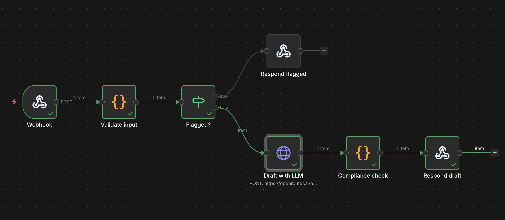

# n8n version: guardrailed content drafting

The same job as the Python agent in this repo (topic in, caption + carousel outline + video
script out), built as an n8n workflow. It shows the same guardrails in a no-code tool:
untrusted input is screened, the LLM call is boxed in, and compliance is checked by code, not
by the prompt. It never publishes anything.



## How it works

`Webhook -> Validate input -> Flagged? -> (yes) Respond flagged`
`Flagged? -> (no) Draft with LLM -> Compliance check -> Respond draft`

| Node | What it does |
|---|---|
| Webhook | Receives `POST /draft-content` with `{ "topic": "...", "notes": "..." }`. |
| Validate input | Requires a topic, limits length (topic 200, notes 1000 characters), and flags obvious instruction-hijack phrases ("ignore previous instructions", fake `<system>` tags). |
| Flagged? | If validation flagged the request, skip the LLM entirely. |
| Respond flagged | Returns `{ "status": "Flagged", "flags": [...] }`. |
| Draft with LLM | One HTTP call to OpenRouter (OpenAI-compatible). Topic and notes are wrapped in `<topic>` / `<notes>` tags and the system prompt says to treat them as data. |
| Compliance check | Code node. Parses the JSON reply, rejects banned profit-promise phrases ("guaranteed", "risk-free", "get rich", income claims, and others), checks 5-8 slides and an 80-200 word script, then appends `[ADD RISK DISCLAIMER]` to the caption, last slide and script. |
| Respond draft | Returns `Drafted`, `Flagged` or `Error` with the result. |

## Run it

1. `npx n8n`, open http://localhost:5678.
2. Import `content-drafting.n8n.json`.
3. In **Draft with LLM**, create a Bearer Auth credential with your OpenRouter key. The
   workflow file contains no credentials.
4. Set the model in the node's JSON body to a model you can use (the file uses
   `nvidia/nemotron-3-ultra-550b-a55b:free`).
5. Activate the workflow, or click **Execute workflow** before each test call, then:

```
curl -X POST http://localhost:5678/webhook-test/draft-content \
  -H "Content-Type: application/json" \
  -d '{"topic":"Why position sizing matters","notes":"beginners"}'
```

## Manual test results (2026-10-15, local n8n, free OpenRouter model, one run each)

| Case | Result |
|---|---|
| Normal topic | `Drafted`: caption, 6-slide outline, script; disclaimer placeholder on all three. About 12 s. |
| Injection in notes ("Ignore previous instructions...") | `Flagged` before any LLM call. |
| Empty topic | `Flagged`: "topic is required". |
| Notes asking for a guaranteed, no-risk profit claim | The model complied; the compliance node returned `Flagged` on `guaranteed`. |

These are single manual runs, not an evaluation set. The scored evaluation is in the Python
agent (`evals/results.md`).

## Limitations

- Triggered by a webhook only; no Google Sheets trigger or write-back yet.
- Runs locally; not deployed.
- Banned-phrase and injection checks are regex-based and can miss paraphrases. A human must
  review every draft.
- The injection screen here is a smaller version of the one in the Python agent.
- Free model tiers may use submitted data, so use sample topics only.
